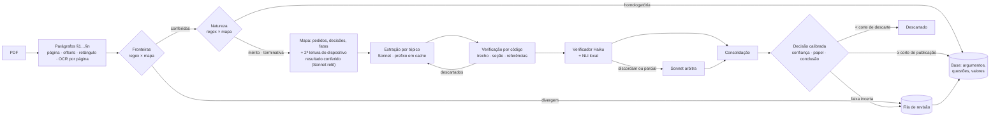

# Questão 2: extração de argumentos de sentenças jurídicas

## Resumo

**A ideia central:** um argumento só entra na base se aponta para um trecho da fundamentação que o sustenta, e quem confere isso é o código. O LLM lê a sentença e propõe argumentos. Cada proposta precisa citar parágrafos numerados e copiar o trecho literal. O sistema confere de forma determinística que o trecho existe dentro de um dos parágrafos indicados, sem atravessar a borda entre dois, que está na fundamentação e não no relatório, e que não foi recortado logo depois de um "não". O texto gravado é sempre o da sentença, nunca a cópia feita pelo modelo. Depois, uma verificação em cascata confere se o trecho, lido no seu parágrafo, sustenta o resumo: um verificador LLM e um modelo de inferência textual local, de outra família; quando os dois discordam, ou o verificador fica em "parcial", um modelo maior arbitra. O que não passa é descartado e não chega à base.

**Decisões de desenho:**
1. **A sentença é lida pela estrutura do art. 489 do CPC, e pela sua natureza.** O relatório traz os argumentos **das partes**, a fundamentação traz os **do juiz** e o dispositivo traz o que foi decidido. Argumento do juiz sai da fundamentação (e, só para juros, correção e honorários, do dispositivo). Cada argumento é ligado ao pedido que decide e ao resultado no dispositivo. Esse é o critério de "principal": razão de decidir (*ratio decidendi*) de um pedido, diferente de comentário lateral (*obiter dictum*). Por isso o papel não fica só com o extrator: o código procura o marcador de comentário lateral, o verificador diz se o resultado depende do raciocínio, e a decisão combina os três. Antes de tudo, o comando do dispositivo diz a natureza da sentença: no Juizado Especial do TJSP, só 34% das sentenças julgam o mérito; 50% extinguem o processo sem mérito (a razão da extinção é o único argumento) e 16% homologam acordo (não há argumento do juiz, e nada é extraído).
2. **Posição e trecho são dados do sistema, não do modelo.** O texto é dividido em parágrafos numerados com página, offsets e o retângulo no PDF antes de chegar ao LLM. O modelo devolve ids de parágrafo e citação, e o código converte isso em posição. Lei, súmula, precedente e valor saem do trecho conferido, não do que o modelo declara.
3. **A confiança é calculada, não declarada.** A nota que o LLM dá a si mesmo é mal calibrada. A confiança é uma probabilidade estimada a partir dos sinais de verificação e calibrada no conjunto de referência. O sistema decide sozinho: publica, descarta ou, numa faixa estreita de incerteza, manda para revisão.
4. **Extração e decisão são versionadas separadamente.** Cada extração é uma execução imutável. A decisão (calibração e cortes) é uma camada por cima, que pode ser recalculada sem chamar o LLM. A revisão humana é outra camada, guardada como eventos, e sobrevive a uma nova extração e a embargos que mudam o texto.
5. **Uma versão é medida por várias execuções.** O LLM não é determinístico. Cada versão roda 5 vezes no conjunto de referência; a calibração usa as 5 juntas, e os números e a troca de versão usam a média delas.

**Demonstração:** `demonstracao_questao2.ipynb` executa o código da solução (`q2.py`) sobre 300 sentenças sintéticas em PDF, com gabarito, e um LLM simulado que erra de propósito. A parte determinística (segmentação, natureza, citações, marcadores, referências) roda também sobre 226 sentenças reais do Juizado Especial Cível do TJSP (`sentencas_tjsp.json`, as mesmas da Q1): a regex acha as fronteiras em todas, e 25 conferidas à mão estão certas (caderno §12). Cada afirmação deste documento marcada com (caderno §n) tem uma célula com `assert`.

## Fluxo para cada nova sentença



| # | Etapa | Ferramenta | Saída |
|---|---|---|---|
| 1 | Extrair texto | PyMuPDF; OCR (Google Document AI) para páginas sem texto (o mesmo extrator da Q1) | texto por página, páginas com OCR, `texto_hash` |
| 2 | Numerar parágrafos | código (blocos do PyMuPDF, cabeçalho e rodapé fora, hifenização desfeita) | `§1…§n` com página, `char_ini`, `char_fim`, recuo e retângulo do bloco |
| 3 | Segmentar a estrutura | regex sobre os marcadores das sentenças reais ("É o relatório", "É o breve relato", "Relatório dispensado", "Fundamento e decido.", "DECIDO.", "FUNDAMENTAÇÃO"; no Juizado sem marcador, o que vem depois de "Vistos."; "Ante o exposto", "Posto isso", "Em razão do exposto", "Diante do exposto:" com verbo de comando; "DISPOSITIVO") e títulos de tópico ("Da preliminar de…", "Dos danos morais"); natureza pelo comando do dispositivo; citações pelo recuo, por marcadores e por aspas dentro do parágrafo | seção, tópico, `e_citacao` e `adotado` de cada parágrafo; natureza (mérito, terminativa, homologatória) |
| 4 | Mapa da sentença | Claude Haiku 5.5, saída estruturada; segunda leitura curta só do relatório e do dispositivo; trechos conferidos por código; resultado de cada decisão conferido contra a palavra de resultado do texto, e relido pelo Claude Sonnet 5.5 quando não bate | partes, natureza, pedidos, decisão e valor de cada pedido, fatos tidos como provados, todos com trecho conferido; parágrafos de fronteira, comparados com a regex |
| 5 | Extrair argumentos | Claude Sonnet 5.5, ferramenta obrigatória com JSON Schema estrito montado para a sentença (pedidos e parágrafos como enum), fundamentação inteira no prefixo em *prompt cache* | argumentos candidatos por tópico da fundamentação e, para quantificação, do dispositivo; na terminativa, só a razão da extinção |
| 6 | Verificar | código (trecho, seção, referências, marcadores) + Claude Haiku 5.5 como verificador + NLI multilíngue local (mDeBERTa, por frase); Claude Sonnet 5.5 arbitra quando os dois discordam ou o verificador diz "parcial" | sinais por argumento |
| 7 | Consolidar | código + embeddings (BGE-M3) | sem duplicatas; cobertura dos pedidos conferida |
| 8 | Decidir | regressão logística calibrada; tabela de papel; conclusão pelo dispositivo | argumento publicado, descartado ou em revisão, com papel e conclusão finais |
| 9 | Gravar e indexar | PostgreSQL (referências normalizadas, valores em centavos) + pgvector (questão); agrupamento por questão jurídica, com o placar das posições | busca por questão, posição, norma, precedente, juízo e valor |

O processamento é assíncrono (fila SQS + workers) e idempotente: a chave `(sentenca_id, texto_hash, versao_extracao)` impede execuções duplicadas (caderno §9). A exceção é a execução `parcial`, em que alguma unidade (um tópico, uma verificação) não respondeu no formato nem depois do reparo: ela é reprocessada, não revisada (caderno §2). O PDF original fica imutável no S3. Os dados de saída ficam em PostgreSQL: tabelas relacionais para o que é filtrado e JSONB para a resposta bruta do modelo.

**Por que cada modelo.** Extrair exige interpretar a fundamentação inteira de um tópico: separar razão de decidir de comentário, ligar ao pedido e resumir sem distorcer; vai para o Sonnet. Verificar é uma tarefa curta e fechada (um trecho, um resumo, quatro perguntas), que um modelo menor faz bem e barato; vai para o Haiku. O verificador recebe menos contexto que o extrator: o parágrafo do trecho, com o trecho marcado, o anterior, os parágrafos de apoio e os fatos provados que o argumento usa, sem a sentença inteira. Assim ele julga o que está escrito, e não o que o resto do texto sugere. O erro que sobra é o resumo distorcido que o verificador aprova: para o sinal, ele é igual a um argumento correto, e nenhum corte o separa. Contra ele entra uma segunda opinião que erra em casos diferentes: um modelo de inferência textual (NLI) multilíngue, de outra família, rodando local e sem custo de API, pergunta se o parágrafo do trecho (com os de apoio) implica o resumo. A comparação é por frase, como no SummaC: cada frase do resumo contra cada frase do parágrafo, e vale a frase do resumo pior sustentada, porque um NLI treinado em pares curtos perde a implicação quando a premissa é um parágrafo inteiro. O limiar do NLI sai dos argumentos rotulados da calibração (o meio do platô de máximo índice de Youden) e faz parte da versão de extração. O Sonnet arbitra, com a mesma pergunta, quando o verificador diz "sustenta" e o NLI discorda, e também quando o verificador diz "parcial": sem árbitro, esse caso iria para um humano. No caderno, com taxas simuladas, 16% dos argumentos são arbitrados; no conjunto real, a taxa é medida na calibração. Se os erros do NLI e do verificador fossem os mesmos, a taxa de inventados não cairia, e o gate da seção 6 mostraria isso.

**Custo por sentença**, em tokens (o preço é o vigente de cada modelo na hora de calcular, não fica no código). A média é ponderada pela proporção real das naturezas no Juizado (34% mérito, 50% terminativa, 16% homologatória), não pela do conjunto de teste, que sobreamostra o mérito:

| Chamada | Quantas: mérito / terminativa / homologatória / média ponderada (caderno §10) | Tokens de entrada |
|---|---|---|
| Mapa (Haiku) | 1 / 1 / 1 / 1 | a sentença inteira; a sentença longa, só relatório, dispositivo e a vizinhança das fronteiras |
| Segunda leitura do dispositivo (Haiku) | 1 / 0,4 / 0 / 0,5 | relatório e dispositivo |
| Releitura do resultado (Sonnet) | só quando o resultado do mapa não bate com o texto | o pedido e o dispositivo |
| Extração (Sonnet) | 4,1 / 2,3 / 0 / 2,5: 1 por tópico, mais reextrações e extrações dirigidas | o prefixo (pedidos, fatos provados, fundamentação, dispositivo) é escrito no cache uma vez e lido nas outras chamadas; só o tópico é pago a preço cheio |
| Verificação (Haiku) | 5,5 / 1,1 / 0 / 2,4: 1 por argumento | ~700 (parágrafo, apoio, fatos usados, tese, resumo e resultado do pedido) |
| Arbitragem (Sonnet) | 0,9 / 0,1 / 0 / 0,4 | ~700 |

A homologatória custa uma chamada de Haiku. Nas sentenças de mérito do caderno, 68% dos tokens de entrada do extrator são leitura de cache (caderno §10); a proporção cresce com o número de tópicos. No Juizado real não há títulos de tópico e a maior sentença tem ~4.800 tokens: a fundamentação é uma unidade só, e a economia do cache aparece nas sentenças de vara, com vários tópicos.

## 1. Saída estruturada

Os campos pedidos no enunciado: **título** → `tese` (a posição do juiz numa frase), com a `questao` que ela responde; **resumo** → `resumo`; **trecho citado** → `trechos[].texto`, recortado da sentença, nunca copiado do modelo; **posição no documento** → `paragrafo`, `pagina`, `char_ini`/`char_fim` e `retangulos` no PDF; **confiança** → `confianca`, calibrada; **tipo** → `tipo`, mais o `papel` (*ratio* ou *obiter*).

**Sentença (uma por documento):**

| Campo | Exemplo |
|---|---|
| `processo`, `tribunal`, `orgao`, `juiz`, `data` | `0801234-56.2025.8.26.0100`, TJSP, 3ª Vara Cível |
| `classe`, `assuntos` | tabelas do CNJ (TPU) |
| `natureza` | `merito`, `terminativa` (extinção sem mérito) ou `homologatoria` (acordo) |
| `pedidos[]` | `{id: "P2", texto: "danos morais de R$ 20.000", §: [4], trecho: "..."}` |
| `decisoes[]` | `{pedido: "P2", resultado: "procedente_em_parte", valor_centavos: 800000, §: [41], trecho: "..."}` |
| `fatos_provados[]` | `{fato: "o réu não provou a contratação", §: [20], trecho: "..."}` |
| `segredo_de_justica`, `dados_sensiveis` | `false`, `[]` |
| `texto_hash`, `paragrafos[]`, `paginas_ocr` | base para todos os offsets |

**Argumento (vários por sentença):**

```json
{
  "id": "arg_8f3c",
  "linhagem_id": "lin_21aa",
  "questao_id": "q_0412",
  "questao": "A inscrição indevida em cadastro de inadimplentes gera dano moral sem prova do abalo?",
  "tese": "A inscrição indevida em cadastro de inadimplentes gera dano moral presumido",
  "resumo": "O juiz entende que a negativação sem débito comprovado gera dano moral in re ipsa, sem necessidade de prova do abalo.",
  "tipo": "merito_direito",
  "por_que_papel": "Sem o dano presumido não haveria fundamento para condenar: a parte autora não provou abalo concreto.",
  "papel": "ratio_decidendi",
  "pedidos": ["P2"],
  "conclusao": "acolhe",
  "favorece": "autor",
  "valor_centavos": null,
  "fundamentos_normativos": [{"norma": "CDC", "artigo": "14"}],
  "precedentes": [{"tribunal": "STJ", "tipo": "sumula", "numero": "385"}],
  "trechos": [
    {"papel": "principal", "paragrafo": 33, "pagina": 7, "char_ini": 18420, "char_fim": 18733,
     "texto": "A inscrição indevida do nome do consumidor em cadastros de proteção ao crédito configura dano moral in re ipsa...",
     "retangulos": [[60.0, 534.3, 507.6, 549.4], [60.0, 550.6, 514.3, 565.7]],
     "e_citacao": false, "adotado": false}
  ],
  "paragrafos_apoio": [],
  "secao": "fundamentacao",
  "topico": "Dos danos morais",
  "sinais": {"casamento": "exato", "sustenta": "sim", "postura": "adota", "necessario": true, "nli": 0.91, "escalado": false,
             "papel_extrator": "ratio_decidendi", "marcador_obiter": false, "marcador_alegacao": false,
             "referencias_removidas": [], "tese_com_caso": false},
  "confianca": 0.99,
  "status": "publicado",
  "texto_hash": "9715c32e204e7f40",
  "extracao_run_id": "run_5d10",
  "versao_decisao": "dec_7637"
}
```

**`questao`, `tese` e `resumo`.** A `questao` é a pergunta jurídica que o argumento responde, neutra: a mesma para o juiz que decide a favor e para o que decide contra ("A inscrição indevida gera dano moral sem prova do abalo?"). É ela que vai para o embedding e para o agrupamento. A `tese` é a resposta que este juiz dá, em termos gerais, sem fato, valor nem parte do caso ("A inscrição indevida gera dano moral presumido"). O `resumo` diz como ele a aplicou a este caso. O verificador confere tese e resumo contra o trecho. Questão ou tese que traz fato do caso (valor, prazo, nome de parte, número de processo) é marcada pelo código (`tese_com_caso`): o argumento vale, mas não entra no agrupamento.

**O que é um argumento** (mesmo texto no prompt e no guia de anotação): uma razão autônoma que, sozinha, leva (ou contribui) à conclusão sobre um pedido. Reformulação, exemplo ou reforço da mesma razão é o mesmo argumento. Duas razões diferentes no mesmo parágrafo são dois argumentos.

**Tipos (enum fechado, pela função do argumento na decisão):**

| Tipo | O que cobre |
|---|---|
| `preliminar_processual` | competência, ilegitimidade, inépcia, interesse de agir, gratuidade |
| `prejudicial_merito` | prescrição, decadência |
| `merito_fato` | valoração da prova, fatos tidos como provados ou não provados |
| `merito_direito` | interpretação e aplicação da norma ao fato |
| `onus_prova` | distribuição e inversão do ônus |
| `quantificacao` | valor do dano, juros, correção, honorários, multa |
| `outro` | o que não cabe nos tipos acima |

Norma e precedente não são tipos: são atributos, porque um argumento de mérito pode se apoiar em ambos. O tipo é um rótulo, não uma questão de veracidade: `outro` é publicado ou não pela confiança, como os demais, e entra na análise de erro. `papel` separa `ratio_decidendi` de `obiter_dictum`; só o primeiro conta como argumento principal na busca padrão. O extrator escreve `por_que_papel` (de que o resultado depende) antes de dar o papel, e essa frase aparece para o revisor. `e_citacao` marca o trecho em que o juiz transcreve doutrina, jurisprudência ou a peça de uma parte.

**`e_citacao` e `adotado` são marcados pelo código, não pelo modelo,** na etapa 3 (caderno §1 e §3). Um parágrafo é citação quando: tem recuo maior que o do corpo do texto (posição horizontal dada pelo PyMuPDF); está inteiro entre aspas; vem logo depois de um marcador ("nesse sentido:", "in verbis", "confira-se:", "colaciono:"); ou tem formato de ementa (abre em caixa alta e traz relator, órgão ou data). Ementa transcrita é o erro mais comum nessa tarefa, porque o texto parece raciocínio do juiz: citação nunca é trecho principal. A exceção é a fundamentação *per relationem*: quando o parágrafo anterior diz "adoto como razões de decidir", "faço minhas as razões" ou equivalente, o bloco citado é `adotado` e vale como trecho principal, porque o juiz o tornou seu.

**Posição no documento:** `paragrafo`, `pagina` e offsets sobre o texto normalizado identificado por `texto_hash`, e `retangulos` no PDF original (coordenadas das linhas do trecho na página, achadas pelo PyMuPDF dentro do bloco do parágrafo). Os offsets servem à base e à linhagem; os retângulos, à tela de revisão, que destaca o trecho no PDF que o advogado conhece. Offsets sem o hash não valem nada: um novo OCR ou embargos mudam todos eles (seção 6).

**Normalização das referências:** "art. 14 do Código de Defesa do Consumidor", "CDC, art. 14" e "art. 14 da Lei 8.078/90" viram `{norma: "CDC", artigo: "14"}` por um dicionário de leis e regex, não pelo LLM. Precedentes viram `{tribunal, tipo, numero}`. É isso que torna a base consultável ("todos os argumentos que afastam a Súmula 385 do STJ no TJSP").

**Valores:** o valor de cada decisão e de cada argumento de `quantificacao` sai do trecho conferido, em centavos. É por ele que a quantificação se agrega: "quanto o TJSP fixa de dano moral por negativação indevida" é uma mediana sobre `decisoes[].valor_centavos`, filtrada por assunto e tribunal (caderno §11).

**Questão (a mesma pergunta em sentenças diferentes, e o placar):** na etapa 9, entram só razões de decidir dos tipos de direito (`merito_direito`, `preliminar_processual`, `prejudicial_merito`, `onus_prova`). Valoração de prova é do caso, e quantificação se agrega pelo valor. Também ficam fora o argumento cujo tipo o verificador contestou, a questão ou tese com fato do caso e a sentença com segredo ou dado sensível. O agrupamento é pela questão, não pela tese. Um embedding denso separa mal "afasta" de "não afasta": agrupar pelas teses juntaria posições opostas sem dizer quem ficou de que lado, ou separaria a mesma questão sem mostrar o placar. Um argumento entra na questão cujo representante tenha cosseno ≥ 0,88 com a sua e, se os dois citam normas ou precedentes, pelo menos um em comum; senão funda uma questão nova e vira o representante dela. O tipo não entra na comparação: é um rótulo do modelo, e um tipo errado partiria a mesma questão em duas. O representante é fixo, para a questão não derivar à medida que cresce. Cada questão guarda o placar (`favorece`) e as teses de cada lado. O limiar não é chutado: é escolhido em pares de argumentos anotados como "mesma questão" e "questão diferente" no conjunto de referência, para precisão de pares ≥ 90%. É a questão que transforma a lista de argumentos numa base: "nas negativações com inscrição anterior, quantos juízes do TJSP aplicam a Súmula 385 e quantos a afastam, e por quê". No caderno, as duas posições sobre a Súmula 385 caem na mesma questão, com o placar dos dois lados; precisão de pares de 99,3% (caderno §11).

**Dados pessoais e sigilo.** Sentenças trazem nome, CPF e, às vezes, dados de saúde ou de menores. Questão, tese, resumo e embedding vão para a base sem nome de parte nem identificador: o código troca os nomes das partes (vindos do mapa) por "a parte autora" e "a parte ré" e mascara CPF, CNPJ e e-mail antes de gravar (caderno §3). O trecho (`trechos[].texto`) guarda o texto original, com nomes, e vive só na conta do cliente que enviou a sentença, como os argumentos. Dado sensível (art. 11 da LGPD) é detectado por dicionário e regex no texto inteiro (CID, termos de saúde, criança e adolescente, orientação sexual, religião, origem racial, biometria) e grava `dados_sensiveis`. As questões, que agregam argumentos de clientes diferentes, só recebem argumentos de sentenças sem segredo de justiça e sem dado sensível; o detector prefere o falso positivo, cujo custo é só ficar fora do agrupamento (nas 226 sentenças reais, 18 marcadas, todas por termos de saúde: caderno §12). As chamadas ao modelo usam retenção zero de dados, e o NLI roda local.

## 2. Como reduzir argumentos inventados

O risco tem três formas, e cada uma tem um controle próprio:

| Falha | Exemplo | Controle |
|---|---|---|
| **Inventado** | argumento que não está no texto, trecho recortado que inverte o sentido, ou resumo que diz o que o trecho não diz | trecho literal obrigatório, conferido por código, inclusive na borda; verificação do resumo em cascata (verificador, NLI, arbitragem) |
| **Atribuído errado** | argumento do réu apresentado como do juiz | só parágrafos da fundamentação; marcador de alegação; o verificador pergunta "o juiz adota isto?" |
| **Detalhe inventado** | trecho certo, mas com um REsp, artigo ou valor que não existe | toda referência precisa estar escrita num parágrafo do juiz; valor só sai do trecho |

**Na entrada:**
- O texto vai com os parágrafos numerados (`[§33] ...`). O schema obriga cada argumento a ter `paragrafos[]` e `citacao_literal`. Sem trecho, não há argumento.
- A saída é uma ferramenta obrigatória com JSON Schema estrito (decodificação restrita), gerado do modelo Pydantic: enums fechados, nenhum campo fora do schema. O schema é montado para cada sentença: `pedidos` só aceita os ids do mapa e `paragrafos` só os § da fundamentação e do dispositivo, então pedido inexistente e parágrafo do relatório não podem ser escritos. Limites de tamanho são conferidos pelo Pydantic na volta (caderno §2).
- A Citations API da Anthropic também devolve o trecho recortado da fonte, mas não funciona junto com a saída estruturada estrita, e a extração precisa do schema. A verificação por código dá a mesma garantia (o texto gravado é o da sentença) e confere o que a Citations não confere: a borda do parágrafo, a negação logo antes do trecho, a seção e a citação que o juiz não adota.
- O prompt define o que é um argumento (seção 1), pede só argumentos da fundamentação e aceita lista vazia. Não há meta de quantidade ("extraia 5 argumentos") que force o modelo a completar.
- O texto da sentença vai como dado, delimitado, com a instrução de ignorar qualquer instrução escrita nele.

**Resposta fora do formato.** `max_tokens` é proporcional ao tamanho do tópico. Resposta cortada nesse limite, sem a ferramenta ou fora do schema ganha uma nova tentativa, com o erro na mensagem e o dobro de `max_tokens`. Se falhar de novo, só aquela unidade falha: a execução fica `parcial`, os outros tópicos seguem, e a sentença é reprocessada (caderno §2).

**Segmentação conferida duas vezes.** Se a fronteira entre relatório e fundamentação sair errada, o sistema publica argumento da parte como se fosse do juiz. Por isso a fronteira é achada de dois jeitos: pela regex da etapa 3 e pelo mapa da sentença (etapa 4), que devolve o parágrafo onde começa a fundamentação e o parágrafo onde começa o dispositivo. A regex usa os marcadores das sentenças reais: "É o relatório", "É o breve relato", "Relatório dispensado", "Fundamento e decido.", "DECIDO." e, no Juizado que não tem marcador nenhum, o que vem depois de "Vistos.". Para ela, o dispositivo é o título DISPOSITIVO ou, sem ele, o **último** "Ante o exposto", "Posto isso", "Em razão do exposto" ou "Diante do exposto:" com verbo de comando (julgo, condeno, declaro, extingo, homologo, indefiro, reconhecendo). O "Ante o exposto, rejeito a preliminar" que fecha um tópico é comum e, tomado como dispositivo, cortaria todo o mérito. Se os dois coincidem (com tolerância de um parágrafo, o do título), a fronteira vale. Se só um achou, vale o que achou. Se divergem, a sentença vai para revisão como "segmentação incerta" antes da extração, porque todo o resto depende disso (caderno §4). Sentença de Juizado Especial dispensa o relatório (art. 38 da Lei 9.099/95): o marcador é detectado, e os pedidos passam a vir da fundamentação e do dispositivo. Nas 226 sentenças reais do Juizado do TJSP, a regex acha as duas fronteiras em todas, e 25 conferidas à mão estão certas (caderno §12).

**Natureza da sentença.** O mesmo comando do dispositivo diz a natureza: `julgo procedente/improcedente` é mérito; `homologo o acordo` é homologatória; `julgo extinto sem resolução do mérito`, `reconhecendo a incompetência`, `indefiro a petição inicial` e a desistência homologada são terminativas. O mapa também devolve a natureza, e as duas leituras são conferidas como as fronteiras. Se divergem, vale mérito, a extração completa: tratar uma homologatória como mérito custa chamadas, e a verificação descarta o que não é do juiz; tratar um mérito como homologatória perderia todos os argumentos. A homologatória não é extraída (o acordo é das partes); a terminativa só tem a razão da extinção (`preliminar_processual` ou `prejudicial_merito`), procurada também no dispositivo, onde às vezes está sozinha ("Tendo em vista a paralisação do processo por mais de 30 dias, JULGO EXTINTO...").

**O mapa também é conferido.** Pedidos, decisões e fatos do mapa trazem trecho literal, conferido pela mesma regra dos argumentos; o que não tem trecho conferido não entra. Um pedido que o mapa esquece não dispararia a checagem de cobertura e passaria em silêncio. Por isso há uma segunda leitura, curta e barata (Haiku, só relatório e dispositivo, com a lista do que já foi achado), que devolve só as decisões e os pedidos que faltam (caderno §4). O trecho prova que a decisão existe, não qual foi o resultado, e um resultado errado não fica só nele: a verificação 7 impõe a conclusão do dispositivo a todas as razões de mérito do pedido. Por isso o código confere o resultado do mapa contra a última palavra de resultado escrita no parágrafo até o fim do trecho ("JULGO PARCIALMENTE PROCEDENTES os pedidos para: (a) declarar..." é procedente; "e julgo improcedente o pedido de danos morais" é improcedente). Se não bate, o Sonnet relê o dispositivo só para aquele pedido, e a resposta dele vale. No caderno, com o mapa invertendo todos os resultados, as decisões finais saem todas certas (caderno §4).

**Verificação determinística (código, sem LLM; caderno §3):**
1. **O trecho existe:** `citacao_literal` é procurada dentro de cada parágrafo citado, um de cada vez, palavra por palavra (pontuação e aspas não contam). Um trecho nunca atravessa a borda de um parágrafo: o fim do §16 colado ao começo do §20 forma uma frase que o juiz não escreveu. Os outros parágrafos citados ficam como `paragrafos_apoio`. Primeiro por casamento exato. Se falhar e a página passou por OCR, as duas versões são alinhadas palavra a palavra, e só são aceitas trocas de caractere do mapa de confusões de OCR (`rn`↔`m`, `l`↔`1`, `o`↔`0`…). Em página com texto nativo não há erro de OCR, e a cópia tem de ser exata. Palavra inserida, removida ou trocada, dígito diferente ou prefixo de negação (não, in-, im-, des-) reprova: "configura" → "não configura" muda poucos caracteres, mas inverte o argumento. Também reprova o trecho que começa logo depois de um "não", "nem" ou "nunca" da fonte: "configura dano moral" copiado de "não configura dano moral" é substring literal e tem o sentido oposto. **O texto gravado e o enviado ao verificador são os da sentença, recortados pelos offsets encontrados, nunca a cópia do modelo.**
2. **Está na seção certa:** parágrafo no relatório ou citação não adotada não pode ser trecho principal, nem o trecho que cai dentro de aspas longas no meio do parágrafo do juiz. No texto exportado do e-SAJ, o parágrafo do juiz e a ementa que ele transcreve vêm na mesma linha ("...entendimento do C. STJ: "A jurisprudência desta Corte..." (AgInt no REsp...)"): a frase do juiz vale, a do STJ não (caderno §12). O dispositivo só vale para `quantificacao`, porque juros, correção e honorários costumam ser fundamentados ali ("juros desde o evento danoso, Súmula 54 do STJ"), e, na sentença terminativa, para a razão da extinção. Tipo que a unidade de extração não admite também descarta.
3. **Referências conferem:** cada norma e precedente do argumento precisa ser encontrado pela regex num parágrafo citado que seja do juiz: fundamentação (ou dispositivo, na quantificação), fora de citação não adotada. A Súmula que só o réu invoca no relatório não entra no argumento do juiz, mesmo que o modelo cite o parágrafo do relatório. O que não for encontrado é removido do argumento (o argumento continua; a referência inventada sai). As referências escritas no próprio trecho entram mesmo que o modelo não as tenha listado.
4. **Pedido existe:** `pedidos[]` precisa apontar para um pedido do mapa da sentença (o enum do schema já impede o contrário; o código confere de novo).
5. **Marcador de alegação:** o código marca o trecho que começa atribuindo a fala a uma parte ("Sustenta o réu que…", "A ré alega…"). É um sinal, não um descarte: o juiz às vezes recita a alegação para rebatê-la no mesmo parágrafo.
6. **Marcador de comentário lateral:** "Registro, apenas para esclarecimento…", "Anoto que…", "ainda que assim não fosse", "a título de argumentação", do início do parágrafo até o fim do trecho. É um dos três sinais do papel.
7. **Conclusão pelo dispositivo:** para uma razão de mérito ligada a pedidos com o mesmo resultado, o dispositivo impõe a conclusão e o lado favorecido (procedente → acolhe, a favor do autor; improcedente → rejeita, a favor do réu). Pedido procedente em parte, preliminar, prejudicial e ônus da prova ficam com o que o extrator disse, porque o dispositivo não decide sozinho.

Uma falha em 1 ou 2 descarta o candidato. Se algum candidato do tópico for descartado, o tópico ganha uma nova tentativa, com os erros na mensagem, pedindo só a versão corrigida dos descartados. Os candidatos já aceitos ficam: uma nova lista inteira poderia perder um argumento certo que não voltasse. Se a correção falhar de novo, o descarte fica registrado e conta como falha na métrica de qualidade.

**Verificação semântica, em cascata (por argumento):**
- **Verificador (Claude Haiku 5.5):** recebe o parágrafo do trecho, com o trecho marcado, o parágrafo anterior, os parágrafos de apoio e os fatos provados que o argumento usa, a tese, o resumo e o resultado, no dispositivo, do pedido ligado. O apoio importa porque o extrator é instruído a usar o fato que o juiz fixou em outro tópico: sem ver esse fato, o verificador diria "parcial" a um resumo certo. A razão em si tem de estar no trecho. O parágrafo inteiro importa porque uma negação ou ressalva fora do trecho ("Não é verdade que…") muda o sentido dele. Responde com saída estruturada, escrevendo a justificativa antes do veredito: (a) o trecho sustenta a tese e o resumo? (`sim`/`parcial`/`não`); (b) o juiz adota o raciocínio ou o relata? (c) o resultado do pedido depende deste raciocínio, ou é observação de passagem? (d) o tipo está correto?
- **NLI local:** um modelo de inferência textual multilíngue (mDeBERTa treinado em NLI) diz, frase a frase, se o parágrafo do trecho e os de apoio implicam o resumo.
- **Arbitragem (Claude Sonnet 5.5):** quando o verificador diz `sim` e o NLI não vê implicação, ou quando o verificador diz `parcial`, o modelo maior responde às mesmas perguntas, e a resposta dele vale. O argumento ganha o sinal `escalado`.

**Decisão (o sistema decide; a revisão é a exceção):**
- falhou na verificação determinística, ou verificador = `não`, ou "relata" → **descartado**;
- marcador de alegação com verificador dizendo "adota" (código e verificador discordam) → **em revisão**;
- confiança ≥ corte de publicação → **publicado**;
- confiança < corte de descarte → **descartado**;
- entre os dois → **em revisão**.

A confiança é a saída de uma regressão logística sobre os sinais (veredito final, score do NLI, casamento exato ou por OCR, referências removidas, tipo contestado, tipo `outro`, reextração, citação adotada, fusão de candidatos, marcador de alegação, arbitragem). Ela é treinada nas sentenças de calibração do conjunto de referência (seção 5), com as 5 execuções da versão juntas. O rótulo que ela prevê é **correto**: o argumento corresponde a um argumento de referência e o trecho o sustenta. O sinal de cada peso é restrito: um sinal de problema (referência removida, OCR, reextração, tipo contestado…) nunca aumenta a confiança, mesmo que a amostra de calibração sugira o contrário por acaso. Um REsp inventado que, no resto, estava certo não pode virar prêmio. Sinal com peso zero na calibração continua na lista: no caderno, os erros simulados são independentes e vários sinais ficam em zero, inclusive o score do NLI, cuja informação a arbitragem já usou; no conjunto real, quem decide é a calibração.

Os cortes saem das probabilidades fora da amostra (validação cruzada por sentença, com a mesma sentença na mesma dobra em todas as execuções), nunca das que a própria regressão ajustou:
- **Publicação:** o menor corte em que a precisão esperada dos publicados (a média das probabilidades calibradas) é ≥ 95%, sem publicar nenhum argumento com probabilidade abaixo de 0,80. Procurar o corte direto nos rótulos o faz saltar entre rodadas, porque cada combinação de sinais entra ou sai inteira. E só a precisão acumulada deixaria publicar uma faixa ruim, que passa por estar misturada à massa de alta confiança.
- **Descarte:** o maior corte em que os argumentos corretos esperados abaixo dele são no máximo 2% do total.

**Papel e conclusão finais.** O papel sai de uma tabela com as oito combinações de três sinais (marcador de comentário lateral, papel dado pelo extrator, "necessário?" do verificador), cada uma levada ao papel que os anotadores deram à maioria dos argumentos dela nas sentenças de calibração. Quem vence quando extrator e verificador discordam sai dos dados, não de uma regra escolhida à mão. Combinação com menos de 5 exemplos: o marcador decide; sem ele, obiter só se extrator e verificador concordarem. Depois do papel, uma razão de mérito recebe a conclusão que o dispositivo impõe (verificação 7). Os dois ficam na camada de decisão, junto com a regressão: saem dos sinais gravados e são recalculados sem chamar o LLM. O sistema regrava o rótulo; nada disso vai para a fila.

No caderno, média de 5 execuções nas 200 sentenças de teste, com o mínimo e o máximo: precisão de 98,3% (97,7% a 98,7%), 96,4% na busca padrão (só *ratio*), inventados em 0,2% (0% a 0,3%), papel certo em 98,2% dos publicados casados e erro de calibração de 0,012. Os dois cortes da versão saíram iguais (0,81): com a arbitragem do "parcial", não sobra faixa incerta, e o sistema publica ou descarta (caderno §6).

**Cobertura (contra o erro oposto, o argumento esquecido):** cada decisão do dispositivo precisa ter pelo menos um argumento que possa ser razão de decidir ligado ao seu pedido. Um pedido decidido sem argumento dispara uma extração dirigida ("quais fundamentos o juiz usa para decidir P3?") em cada tópico da fundamentação; o prefixo já está em cache, então isso custa pouco. Se continuar sem argumento, a sentença ganha o aviso "pedido sem fundamento extraído", que conta na métrica de cobertura mas não manda para a fila: pedido consequencial (a exclusão da inscrição decorre da inexistência do débito) muitas vezes não tem argumento próprio.

## 3. Sentenças longas

A maioria das sentenças tem de 5 a 30 páginas e cabe no contexto do modelo. Mesmo assim, a extração não pede todos os argumentos numa chamada só. A unidade de trabalho é o **tópico da fundamentação**, por dois motivos: uma chamada com uma tarefa estreita ("os argumentos do tópico Dos danos morais") deixa menos argumento para trás do que "todos os argumentos da sentença", e uma falha na verificação reextrai só o tópico, não a sentença.

1. **Corte do relatório.** O relatório costuma ser de 20% a 40% do texto e não tem argumento do juiz. Ele não entra na extração; entra só a lista de pedidos do mapa da sentença.
2. **Divisão por tópico.** A fundamentação é dividida pelos títulos do próprio juiz ("Da prescrição", "Do mérito", "Dos danos morais"). No Juizado não há títulos (nenhum nas 226 sentenças reais) e a maior sentença tem ~4.800 tokens: a fundamentação inteira é uma unidade. Sem títulos, ou com um tópico grande demais, a divisão é por blocos de até ~8 mil tokens, cortados só entre parágrafos. Não há sobreposição entre blocos: o contexto global já vai em cada chamada (caderno §5). O dispositivo é um tópico à parte, restrito a `quantificacao` (na terminativa, à razão da extinção).
3. **Contexto global em cada chamada.** Cada chamada recebe os pedidos, os fatos tidos como provados, a fundamentação inteira e o dispositivo, e a instrução de extrair só do tópico X. Isso importa porque o juiz fixa um fato num tópico ("restou provado que não havia débito") e o usa em outro ("Dos danos morais"). Esse prefixo é igual para todos os tópicos da sentença e fica em *prompt cache*, então só a instrução do tópico é paga a preço cheio. Quando a fundamentação passa de ~150 mil tokens, o prefixo troca a fundamentação pelo título e pelo primeiro e último parágrafo de cada tópico, mas mantém os fatos provados inteiros. É por eles que um tópico continua enxergando o fato que outro fixou.
4. **O mapa da sentença longa.** Acima de ~150 mil tokens, o mapa não lê a sentença inteira: lê o cabeçalho e o relatório (pedidos), o dispositivo (decisões) e três parágrafos de cada lado das fronteiras que a regex achou (para conferir a segmentação). Os fatos provados saem de uma leitura curta por tópico (Haiku), antes da extração (caderno §5).
5. **Ids globais.** Os parágrafos mantêm a numeração da sentença inteira, então as posições não precisam ser remapeadas.
6. **Consolidação.** O mesmo argumento pode sair duas vezes: em dois tópicos, ou citado por duas frases diferentes do mesmo parágrafo. Dois candidatos são o mesmo argumento quando os trechos se sobrepõem (IoU dos caracteres ≥ 0,5); quando citam o mesmo parágrafo principal, com o mesmo tipo, um pedido em comum e resumos com cosseno ≥ 0,80; ou quando estão em parágrafos diferentes com o mesmo pedido, o mesmo tipo e resumos com cosseno ≥ 0,85 (BGE-M3). O mesmo parágrafo sozinho não basta: um parágrafo pode trazer duas razões para o mesmo pedido ("o dano é presumido" e "a Súmula 385 não incide porque as inscrições anteriores foram canceladas"), e fundi-las apagaria uma (caderno §5). Os limiares são escolhidos nos pares anotados, como o da questão. A fusão junta os trechos e mantém o resumo do candidato que o verificador melhor avaliou.

Sentenças muito longas (ação civil pública ou recuperação judicial, com centenas de páginas) seguem o mesmo caminho: só aumenta o número de tópicos. Como o prefixo fica em cache, o custo cresce quase linear com a fundamentação, não com o documento.

## 4. Revisão humana

**Tela de revisão na própria plataforma**, porque quem revisa são advogados que já trabalham nela. É uma tela de duas colunas: à esquerda o PDF original da sentença, com os trechos de cada argumento destacados pelos retângulos gravados e as seções (relatório, fundamentação, dispositivo) marcadas; à direita os cartões dos argumentos, agrupados por pedido, com a questão, a tese, o resumo, o `por_que_papel` e a justificativa do verificador. Clicar num cartão rola o PDF até o trecho.

| Ação | Como funciona |
|---|---|
| **Aceitar** | um clique; muda o status para `aprovado` |
| **Editar** | campos editáveis (questão, tese, resumo, tipo, papel, pedido, referências). O trecho é trocado selecionando texto na sentença, então continua sendo um trecho real, com offsets do sistema. A edição passa pela mesma checagem de referências: norma ou precedente que não está escrito no parágrafo gera um aviso na tela (não bloqueia, porque o revisor pode saber o que o texto não diz) |
| **Rejeitar** | motivo obrigatório: `nao_esta_no_texto`, `argumento_da_parte`, `obiter_nao_principal`, `duplicado`, `resumo_distorce`, `irrelevante` |
| **Adicionar** | o revisor seleciona um trecho e preenche o cartão; nasce com `origem = humano` |
| **Juntar / dividir** | une dois cartões ou separa um em dois |

**Quem chega na fila:** os argumentos na faixa entre os dois cortes, os casos em que código e verificador discordam sobre a alegação de parte, e as sentenças com segmentação incerta. Tipo `outro`, pedido sem argumento e falha de formato não vão para a fila: o primeiro é rótulo, o segundo é aviso, e o terceiro é reprocessado. A fila é **por sentença**, não por argumento: o revisor abre a sentença uma vez e vê os itens incertos destacados, com os publicados logo ao lado como contexto. No caderno, 5,4% das sentenças têm algo na fila: segmentação incerta ou alegação de parte que o verificador diz que o juiz adota. Todos os argumentos que chegaram à fila estavam de fato errados: a fila recebe só o que precisa de olho humano (caderno §6).

**Modelo de dados da revisão** (caderno §9):
- `argumento` (o que o modelo extraiu) é imutável;
- `revisao` é uma tabela de eventos, só com inserções: `{argumento_id, linhagem_id, revisor, acao, campos_antes, campos_depois, motivo, ts}`;
- a base consulta a visão `argumento_atual`, que aplica a última revisão sobre a extração. A decisão do modelo nunca é apagada: ela e a correção juntas são o rótulo usado na avaliação;
- dois revisores na mesma sentença não sobrescrevem um ao outro: cada revisão informa quantos eventos a linhagem tinha quando a tela abriu, e é recusada se outro evento entrou nesse meio-tempo.

## 5. Qualidade da extração

**Conjunto de referência:** 300 sentenças estratificadas por natureza, área (cível, consumidor, trabalhista, tributário), tribunal, tamanho e resultado. O mérito é sobreamostrado (2/3 do conjunto, contra 34% no Juizado real), porque é nele que estão os argumentos; terminativas e homologatórias ficam com 1/6 cada, o bastante para medir a natureza e a razão da extinção. As métricas por argumento vêm quase todas do mérito; o custo é ponderado pela proporção real. Dois advogados anotam cada sentença às cegas, sem ver a saída do sistema, e um terceiro resolve as divergências. O guia de anotação usa a mesma definição de argumento do prompt (seção 1). Cada anotador marca todos os argumentos do juiz, *ratio* e *obiter*, com trecho, pedido, tipo, papel, conclusão, a questão e a tese em termos gerais; e, entre argumentos de sentenças diferentes, quais respondem à mesma questão. A concordância entre os dois anotadores é medida com o mesmo casamento usado no sistema: é o teto realista do sistema.

O conjunto é dividido em **100 sentenças de calibração e 200 de teste**. Nas de calibração se ajusta o prompt, a regressão, os cortes e a tabela de papel. As de teste só medem e decidem a troca de versão (seção 6). O teste é maior porque é ele que precisa de poder estatístico.

**Casamento entre extraído e referência:** um argumento extraído corresponde a um de referência quando pelo menos metade do trecho menor está dentro do outro e eles têm um pedido em comum. Contenção, e não IoU, porque o anotador costuma marcar o parágrafo inteiro e o modelo cita uma ou duas frases dele: o IoU daria a uma citação correta um valor baixo. O casamento é um-para-um, pelo algoritmo húngaro.

| Métrica | O que mede | Meta |
|---|---|---|
| **Taxa de inventados** | publicados sem trecho que os sustente, com resumo distorcido ou atribuídos ao juiz quando são de uma parte | ≤ 1% |
| **Precisão** | publicados corretos (correspondem a um argumento de referência, *ratio* ou *obiter*, e o trecho o sustenta) | ≥ 95% |
| **Precisão da busca padrão** | publicados como `ratio_decidendi` que são corretos e *ratio* na referência: o que o usuário vê quando pede os argumentos principais | ≥ 95% |
| **Recall** | argumentos `ratio_decidendi` de referência que foram publicados; e, à parte, os que foram publicados ou ficaram na fila (o recall depois da revisão) | ≥ 85% |
| **Acerto por campo** | tipo, papel, pedido, conclusão; normas e precedentes (precisão e recall exatos após normalização); valores | por campo |
| **Fidelidade do resumo** | nota de 1 a 5 por advogado numa amostra; um juiz LLM com rubrica só é usado depois de concordar com essa nota | ≥ 4 |
| **Cobertura dos pedidos** | decisões do dispositivo com pelo menos um argumento | ≥ 98% |
| **Calibração** | curva de confiabilidade da confiança | erro de calibração ≤ 0,05 |
| **Questões** | precisão dos pares de argumentos postos na mesma questão | ≥ 90% |
| **Fila** | sentenças com algum item em revisão, e a fração dos itens da fila que estão errados | menor possível, dada a precisão |

"Inventado" e "irrelevante" são contados separados. O primeiro corrompe a base; o segundo é ruído que um filtro por `papel` resolve.

Os números do caderno vêm de um LLM simulado com taxas de erro escolhidas para exercitar cada controle. Eles mostram que cada controle funciona e como as métricas se movem, não a qualidade de um modelo real. Lá, recall (81,7%) e cobertura (93%) ficam abaixo da meta porque o extrator simulado esquece 6% dos argumentos e a extração dirigida recupera só parte deles. Precisão, precisão da busca padrão, inventados, calibração e questões (precisão de pares de 99,3%) passam. A parte determinística é medida também em texto real: fronteiras e natureza nas 226 sentenças do Juizado do TJSP, com 25 conferidas à mão (caderno §12).

**Acompanhamento contínuo:**
- **Amostra aleatória de 2% dos publicados** vai para revisão às cegas (o revisor não vê a confiança). Só essa amostra estima a precisão real sem viés; a fila de incertos, por construção, não serve para isso.
- Taxa de rejeição por motivo e de edição por campo, segmentadas por tribunal, área e tamanho. Uma alta em `argumento_da_parte` num tribunal aponta para uma segmentação que falhou com o formato dele.
- Taxa de arbitragem (verificador e NLI discordando, ou veredito "parcial") e de releitura do resultado do mapa, por tribunal e área: uma alta indica resumos mais arriscados ou um verificador que perdeu a mão.
- A confiança é recalibrada só com rótulos sem viés: o conjunto de referência e a amostra aleatória de 2%. Os rótulos da fila de incertos não entram na calibração, porque só contêm casos difíceis. Eles servem para a análise de erro e como exemplos no prompt.

## 6. Versionamento

**Cada execução grava a versão completa do que a produziu:**

| Componente | Como é versionado |
|---|---|
| Prompt (mapa, segunda leitura, fatos, extrator, verificador) | arquivos no git; versão = hash do conteúdo junto com o schema |
| Modelo | id fixo de cada modelo, nunca um alias que muda sozinho: mapa, extrator, verificador e árbitro (`claude-haiku-5-5`, `claude-sonnet-5-5`); o NLI, pelo commit do modelo carregado |
| Schema | semver (`2.1.0`), com o JSON Schema guardado no repositório |
| Código | hash do código de segmentação, natureza, verificação, normalização de referências, consolidação e reparo de formato |
| Parâmetros | hash das constantes que esse código lê (limiar do NLI, limiares de consolidação, limites de tamanho, mapa de confusões de OCR, dicionários) e de todas as regex do módulo, que o hash do código não enxerga |
| Embeddings | modelo e versão do BGE-M3 |
| Decisão | pesos da regressão, cortes e tabela de papel; versão própria (`versao_decisao`) |

`versao_extracao` é o hash dos seis primeiros, os que mudam a saída do LLM ou a verificação: trocar o NLI, o árbitro ou um limiar muda a versão, e trocar um corte da decisão não muda (caderno §8). A calibração fica fora de propósito: os sinais de verificação ficam gravados com cada argumento, então recalibrar reaplica a decisão sobre eles, sem chamar o LLM e sem mudar a chave de idempotência (caderno §8). A tabela `extracao_run` guarda a versão, a resposta bruta do modelo, os tokens e o custo. Os argumentos pertencem a uma execução e nunca são sobrescritos. Cada sentença tem um ponteiro `run_ativo`, e a base consulta só ele.

**Quando algo muda** (caderno §7):
1. **Calibração própria.** Um prompt ou modelo novo muda a distribuição dos sinais. A candidata roda 5 vezes no conjunto de referência e ajusta a própria regressão, os próprios cortes e a própria tabela de papel com as 5 execuções nas sentenças de calibração, juntas. Com uma execução só, o corte salta de uma rodada para outra.
2. **Avaliação antes de trocar.** Cada versão é medida pela soma das suas 5 execuções em cada uma das 200 sentenças de teste. A diferença é medida por *bootstrap* pareado por sentença (as mesmas sentenças reamostradas para as duas versões), como teste de não inferioridade. Como cada sentença traz a média ruidosa das 5 execuções, o intervalo inclui a variação entre execuções. A candidata só vira ativa se:
   - o limite inferior do intervalo de 95% da diferença de F1 for ≥ −3 pontos. A margem é 2× a meia largura desse intervalo com 200 sentenças e 5 execuções (≈1,4 ponto): assim uma versão idêntica à ativa é reprovada em no máximo ~2,5% das vezes. Uma margem menor reprovaria a própria versão ativa rodada de novo; uma margem menor exigiria mais sentenças de teste, não uma regra mais apertada;
   - o limite inferior do intervalo de 95% da diferença na precisão da busca padrão (só *ratio*: o que o usuário vê quando pede os argumentos principais) for ≥ −1,5 ponto, margem derivada do mesmo jeito (meia largura ≈0,7 ponto). Sem esse critério, uma versão que publica *obiter* como *ratio* passa, porque no F1 o *obiter* correto conta como acerto;
   - o limite superior do intervalo de 95% da taxa de inventados da candidata for ≤ 1,5%. É um critério absoluto, não uma folga sobre a ativa, porque inventado é o erro que corrompe a base: uma folga relativa deixaria uma versão passar de 0,1% para quase 2%.

   O caderno roda o teste A/A (a versão ativa em outras 5 execuções), que passa com o intervalo de ΔF1 contendo zero; uma candidata melhor, que passa; uma com o verificador mais fraco, reprovada por F1 (−5 a −7 pontos); e uma que erra o papel, que passa no F1 e é reprovada pela precisão da busca padrão (−0,4 a −2,0 pontos). Os números das versões ficam gravados lado a lado.
3. **Reprocessamento.** As sentenças são reextraídas com a nova versão pela Batch API (assíncrona e mais barata), e o ponteiro `run_ativo` é trocado sentença por sentença. A execução antiga continua consultável, então dá para comparar as duas e voltar.
4. **Mudança de schema.** Campo opcional novo (versão *minor*): as execuções antigas ficam com o campo nulo e só são reextraídas se a consulta precisar dele. Mudança que quebra o schema (*major*), como dividir um tipo em dois: um script de migração converte o que é dedutível e reextrai o resto. A versão do schema vai em cada linha, então a leitura nunca mistura formatos sem saber.
5. **A sentença muda.** Embargos de declaração com efeito modificativo alteram a sentença. A decisão dos embargos entra como documento vinculado, o texto integrado ganha um novo `texto_hash`, e a extração roda de novo sobre ele. Offsets de textos diferentes não se comparam: antes de ligar as linhagens, o texto gravado de cada argumento antigo é procurado no texto novo (pela mesma regra de casamento do trecho), o que gera offsets, página e retângulos novos. O argumento cujo trecho não existe mais no texto novo não herda linhagem; uma revisão humana feita sobre ele volta para a fila como "trecho alterado pelos embargos" (caderno §9).

**O trabalho humano sobrevive à reextração.** `linhagem_id` liga o mesmo argumento entre execuções, pela mesma regra de "mesmo argumento" da consolidação (seção 3, item 6), um para um (algoritmo húngaro). Sem isso, dois argumentos novos podiam herdar a mesma linhagem, e a rejeição de um suprimiria o outro (caderno §9).
- Linhagem **aprovada ou editada** por humano: a versão humana continua valendo, reancorada no texto atual. Se a nova extração discordar dela em tipo, papel, pedido ou conclusão, a diferença é registrada como possível regressão.
- Linhagem **rejeitada** por `nao_esta_no_texto`, `argumento_da_parte`, `duplicado` ou `irrelevante`: o argumento equivalente da nova extração é suprimido, porque o problema está no trecho, e o trecho é o mesmo.
- Linhagem **rejeitada** por `resumo_distorce` ou `obiter_nao_principal`: o argumento equivalente volta para revisão, com a rejeição anterior ao lado, porque a nova extração pode ter corrigido o resumo ou o papel.
- Argumento **adicionado** por humano: é mantido, porque não depende de execução.

Assim, trocar o prompt, o modelo ou o schema não apaga revisões já feitas, e cada argumento da base pode ser rastreado até a sentença, o trecho, a execução e a pessoa que o confirmou.
